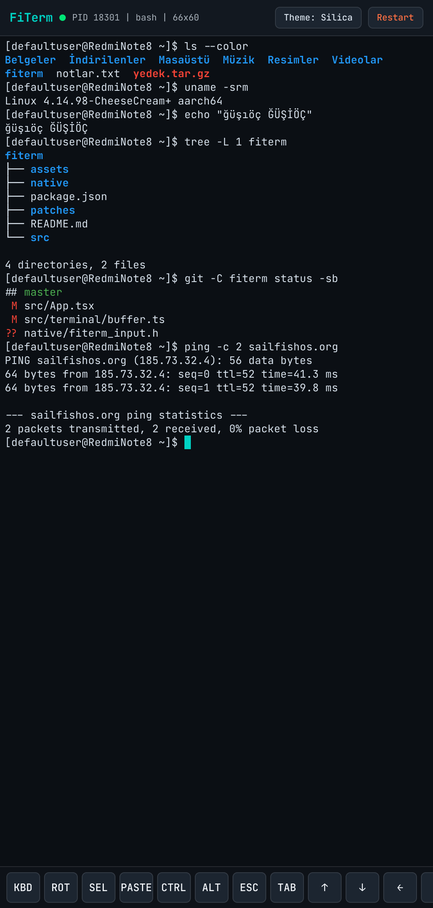
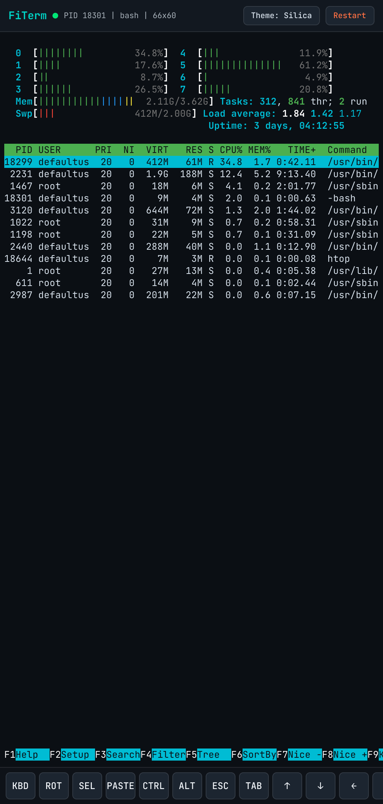
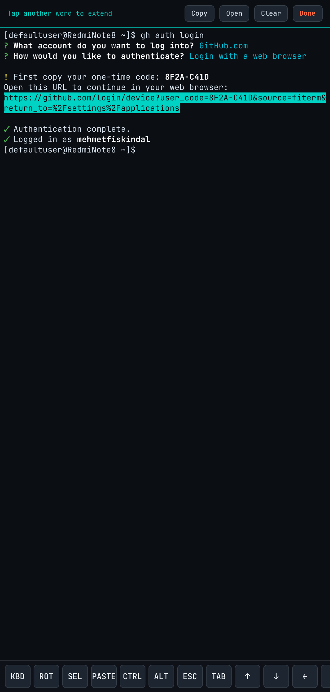
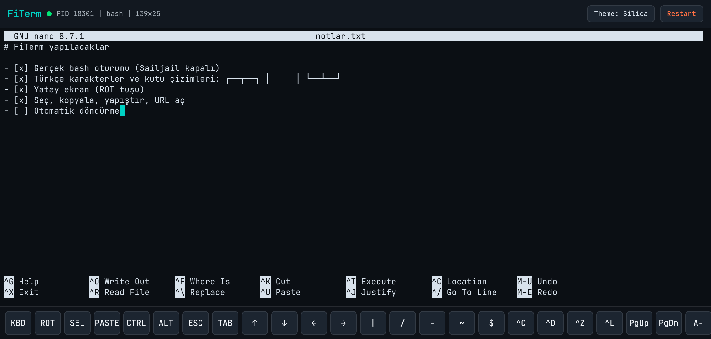

# FiTerm

A terminal emulator for Sailfish OS, written in TypeScript/JSX with
[GeaStack](https://github.com/geastack) and compiled to a native SDL application.
It runs a real login shell on a PTY, outside the Sailjail sandbox.

GeaStack app id: `fiterm`. Package name: `harbour-gea-fiterm`.

## Screenshots

These images are design renders exported from Figma, rebuilt from the app's
layout and colors. They are not captures from a device, and they use JetBrains
Mono where the app itself embeds DejaVu Sans Mono.
[Open the Figma file](https://www.figma.com/design/ZGTtOj0yFQuXDLsJGAATiC).

| Shell | Full-screen programs | Select and copy |
| :---: | :---: | :---: |
|  |  |  |

Landscape, after pressing `ROT`:



## Features

- Real `bash` login shell on a PTY, sized to the screen (66×60 in portrait on a
  1080×2260 display at the default font size).
- xterm-style emulation: scroll regions, insert/delete, alternate screen, 256
  and true color. `htop`, `nano` and `less` work.
- Embedded DejaVu Sans Mono with Latin-1, Turkish, arrows, box-drawing and
  block glyphs.
- Hardware (Bluetooth) keyboard and the Sailfish on-screen keyboard, including
  Ctrl combinations, Esc, Tab and arrow keys.
- Accessory toolbar:

  | Key | Action |
  | --- | --- |
  | `KBD` | Show or hide the on-screen keyboard |
  | `ROT` | Rotate: portrait → landscape → inverted landscape |
  | `SEL` | Select mode: tap a word, tap another to extend, then Copy or Open (URLs) |
  | `PASTE` | Paste the clipboard into the shell |
  | `CTRL` `ALT` | Sticky modifiers for the next toolbar key |
  | `PgUp` `PgDn` | Scroll back through history |
  | `A-` `A+` | Font size |

## Known limitations

- Rotation is manual (`ROT`); there is no automatic rotation from the
  orientation sensor.
- Scrollback is moved with `PgUp`/`PgDn`, not by dragging.
- Underlined text is not drawn.
- The package disables Sailjail sandboxing (`Sandboxing=Disabled`), which a
  terminal needs, so it cannot be published in the Jolla Harbour store.

## Development

```sh
npm install
npx gea dev                 # web preview with a simulated shell
npm run check               # type check
```

### Build and install on a device

The RPM is built on a PC with the Sailfish SDK (`sfdk`). The build engine VM
stalls with 1 GB of RAM; 3.5 GB works.

```sh
# 1. Generate the C++ sources and apply FiTerm's stage patches
GEA_RPIOS_FONT_LATIN_EXTENDED=1 node vendor/geastack-linux/targets/sailfish-os/prepare.mjs "$PWD" aarch64
node patches/geastack-sailfish-build.mjs .gea-sailfish/build/fiterm-aarch64/project

# 2. Build the RPM
cd .gea-sailfish/build/fiterm-aarch64/project
sfdk -c target=SailfishOS-5.1.0.11-aarch64 build -j2

# 3. Install on the device registered in the SDK (confirm on the phone)
sfdk -c target=SailfishOS-5.1.0.11-aarch64 -c device="<device name>" deploy --sdk
```

`patches/geastack-sailfish-build.mjs` is safe to run repeatedly. It adds the
native PTY host, keyboard, clipboard, rotation and glyph coverage to GeaStack's
Sailfish target inside `node_modules`.

Set `FITERM_TRACE=1` when launching `harbour-gea-fiterm` to log input events
and PTY traffic to stderr.

## Layout

| Path | Contents |
| --- | --- |
| `src/App.tsx` | UI, grid sizing, select mode |
| `src/terminal/` | Terminal emulation (`buffer.ts`), SGR colors (`ansi.ts`) |
| `src/platform/host.ts` | Bridge to the native host, plus the web mock shell |
| `native/` | PTY host, key input, clipboard, Maliit keyboard (C++) |
| `patches/` | Build-time patches for GeaStack's Sailfish target |
| `assets/fonts/` | DejaVu Sans Mono (embedded terminal font) |
| `docs/screenshots/` | README images |

## License

MIT. DejaVu Sans Mono is distributed under its own
[free license](https://dejavu-fonts.github.io/License.html).
